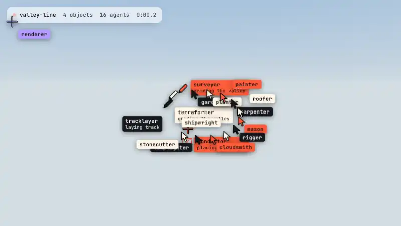

# swarm-build

[](https://github.com/harnoorDev/swarm-build/actions/workflows/test.yml)

**A page that builds itself while you watch.** A crew of labelled agent cursors frames each block with a live `W × H` badge, types the headline, restyles the accents, streams the copy like model output, counts up the stats, ticks off checklists and drags chart bars into place. On 3D sites, a **renderer agent** sweeps the scene in, or the whole crew goes inside and builds it. If you want, a **red-team agent** tries to rewrite your promise, and the **guardrail agent** blocks it.


- **Zero dependencies.** One ES module (~56 KB, ~18 KB gzipped) and one stylesheet (~2.7 KB gzipped).
- **Declarative.** You add `data-swarm` and `data-swarm-step` attributes. No timeline code.
- **Works with 3D sites.** Three.js, React Three Fiber, Babylon, Spline, `<model-viewer>` or a raw WebGL canvas. The scene follows `swarm:scene` progress events (geometry, then materials, then lighting), can make the build wait for its models, and can send any agent to a build site inside it.
- **Built for real sites.** It plays once per session and fast-forwards on any key, click, tap or scroll. Reduced motion and data savers (Save-Data) get the finished page, the text stays in the DOM, and the agent layers are `aria-hidden`.
- **Fails open.** If your own code throws inside a build (a build site, a `doing` line), the error is logged and dropped and the build carries on to the end. A page is never left half-built.
- **Tested.** Every push runs the projector against Three.js and Babylon.js and builds every demo in a real browser.
- **Ships as a Claude skill.** `skills/swarm-build/SKILL.md` teaches Claude how to add it to any site, with a verification checklist.

**Live demos:** [the page demo](https://harnoordev.github.io/swarm-build/), [the 3D world](https://harnoordev.github.io/swarm-build/skills/swarm-build/examples/3d.html), and in production on [iamharnoor.com](https://iamharnoor.com).

## The 3D demo

[](https://harnoordev.github.io/swarm-build/skills/swarm-build/examples/3d.html)

A crew of sixteen builds a Three.js world just ahead of a little steam train: sunflower and lavender fields, a harbour town, a pine forest and a snowy summit station. Almost everything near the line is put up by a cursor. The tracklayer lays the sleepers, the terraformer and surveyor shape the hills, one cursor pulls up three houses and drops their roofs on, and the crew plants the forest tree by tree. Each agent's tag says what it is doing ("planting pines 3/5"), and a log keeps a line for every finished job. When the train pulls in, the camera rises over the whole valley.

[Watch the full 31-second run (MP4)](https://harnoordev.github.io/swarm-build/docs/demo-3d.mp4) · [Open it live](https://harnoordev.github.io/swarm-build/skills/swarm-build/examples/3d.html) · [Read the source](skills/swarm-build/examples/3d.html), a single HTML file.

To build your own, start with [the island starter](https://harnoordev.github.io/swarm-build/skills/swarm-build/examples/3d-starter.html) ([source](skills/swarm-build/examples/3d-starter.html)): four agents build a small island in about 200 commented lines.

Each job is a build site: who does the work, when in the build it happens, where the cursor is right now, and what it says it is doing. `projector` turns your Three.js or Babylon.js camera into the screen points the cursors follow, and every job start and finish arrives as a `swarm:work` event.

```html
<canvas id="world" data-swarm-step="scene" data-swarm-sweep="none" data-swarm-duration="20" data-swarm-await></canvas>
```

```js
import { swarmBuild, projector } from './swarm-build.js';

const swarm = swarmBuild({ crew: { renderer: '#b49bff', mason: '#ff5b3a' } });
const toScreen = projector(camera, canvas);                 // world point or Object3D → screen point
swarm.anchor('tower', () => toScreen([0, 12 * build, 0]), {
  at: 0.4,                                            // scene progress when the work starts
  by: 'mason',                                        // who does it
  hold: 1.6,                                          // seconds on site
  glyph: 'cross',                                     // the cursor it works with
  doing: () => 'raising the tower, floor ' + Math.ceil(build * 12),   // the line under its name
});
swarm.start();
canvas.addEventListener('swarm:work', (e) => console.log(e.detail.agent, e.detail.phase, e.detail.doing));
```

## Use it

```html
<head>
  <script>/* head snippet from skills/swarm-build/references/api.md */</script>
  <link rel="stylesheet" href="swarm-build.css">
</head>

<header data-swarm>
  <span data-swarm-origin class="logo-dot"></span>
  <h1 data-swarm-step="type" data-swarm-attack="without>with">Shipping AI <em>without</em> the breach.</h1>
  <p data-swarm-step="frame stream">Bio streamed in like model output…</p>
  <a data-swarm-step="frame" href="#contact">Get in touch</a>
  <strong data-swarm-step="count">2.2K</strong>
  <p data-swarm-credit hidden>Built by {agents} agents while you watched.</p>
</header>

<script type="module">
  import { swarmBuild } from './swarm-build.js';
  swarmBuild().start();
</script>
```

The steps are `frame` (planner), `type` (writer, with accents restyled by the stylist), `stream` (writer), `fetch` (retriever), `count` (eval), `check` (eval ticks off a list), `grow` (analyst drags each bar of a chart out), `scene` (renderer, for 3D viewports) and `reveal`.

```html
<ul data-swarm-step="check"><li>SOC 2 Type II</li><li>99.99% uptime</li><li>SSO and SCIM</li></ul>

<figure data-swarm-step="frame grow" style="display:flex; align-items:end; gap:12px; height:160px">
  <div data-swarm-bar style="flex:1; height:71%; background:#ff6a3d">71%</div>
  <div data-swarm-bar style="flex:1; height:98%; background:#ff6a3d">98%</div>
</figure>
```

For a 3D viewport that the renderer sweeps in:

```html
<div id="stage" data-swarm-step="scene" data-swarm-await data-swarm-anchors="engine"></div>

<script type="module">
  import { swarmBuild, projector } from './swarm-build.js';
  const swarm = swarmBuild().start();
  const stage = document.getElementById('stage');
  let build = 1;                                            // finished unless the swarm says otherwise
  stage.addEventListener('swarm:scene', (e) => { build = e.detail.progress; });   // drive your scene from it
  loader.load('/plane.glb', () => swarm.ready(stage));      // sweep it in once the model is loaded
  const toScreen = projector(camera, renderer.domElement);  // your Three.js camera and canvas
  swarm.anchor('engine', () => toScreen(engineMesh));       // the renderer follows it on screen
</script>
```

The full reference is in [`references/api.md`](skills/swarm-build/references/api.md). For existing intros, GSAP and SplitText, Lenis, Next.js, 3D sites and custom crews, see [`references/integration.md`](skills/swarm-build/references/integration.md). What changed between versions is in the [changelog](CHANGELOG.md).

## Install the Claude skill

- **With the skills CLI:** `npx skills add harnoorDev/swarm-build --skill swarm-build`
- **Claude Code by hand:** copy `skills/swarm-build` into `~/.claude/skills/` (or `.claude/skills/` in a project).
- **claude.ai:** zip the `skills/swarm-build` folder and upload the zip as a custom skill.

Then ask: *"add the swarm build effect to my site"*.

## Tests

```bash
npm install --no-save playwright three @babylonjs/core && npx playwright install chromium
node --test tests/*.test.mjs
```

`tests/projector.test.mjs` checks `projector` against Three.js and Babylon.js, and `tests/smoke.test.mjs` builds every demo in headless Chromium and fails on any error or anything left behind. They run on every push.

## Credit

Inspired by [Swarm](https://github.com/califa/swarm-site) by Joel Califa, a website that builds itself as you scroll. This is an independent implementation written from scratch, with no code or artwork from that project.

## License

MIT © Harnoor Singh
